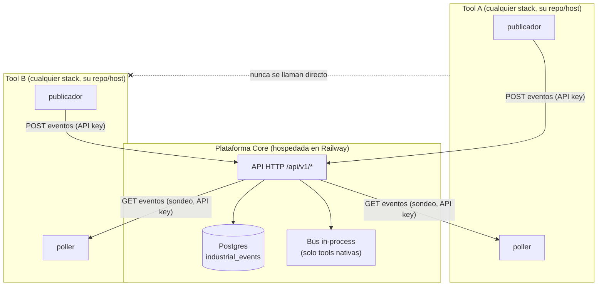
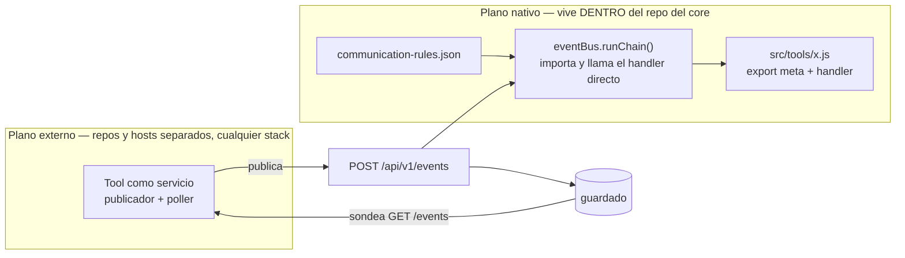
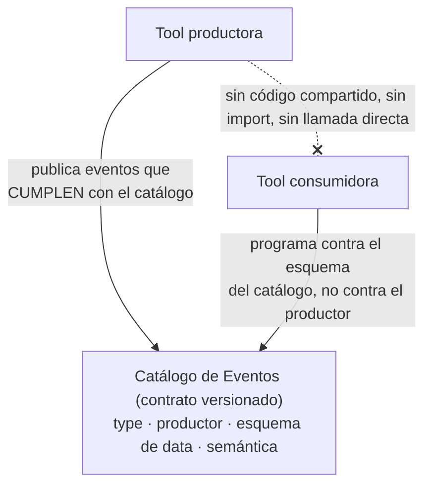
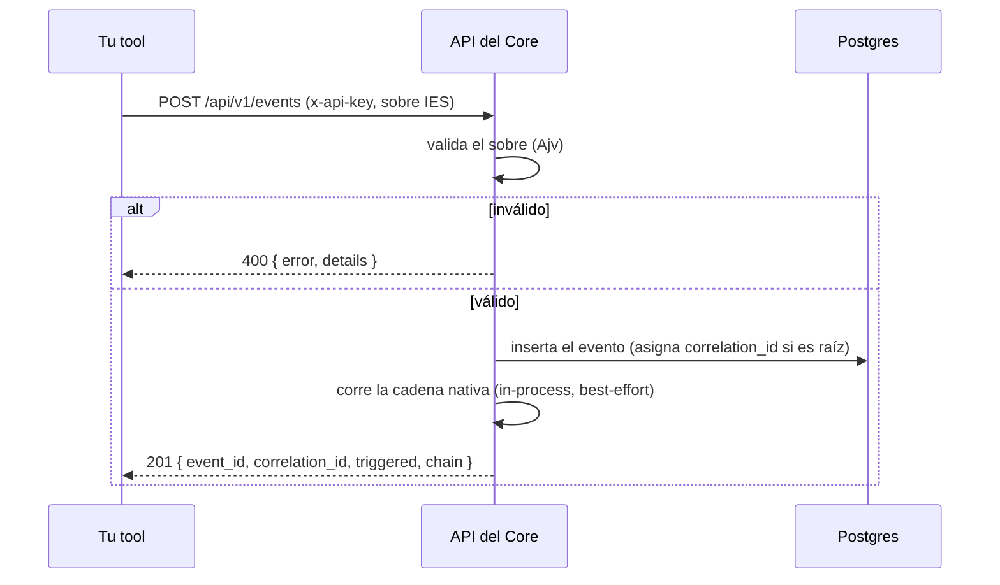
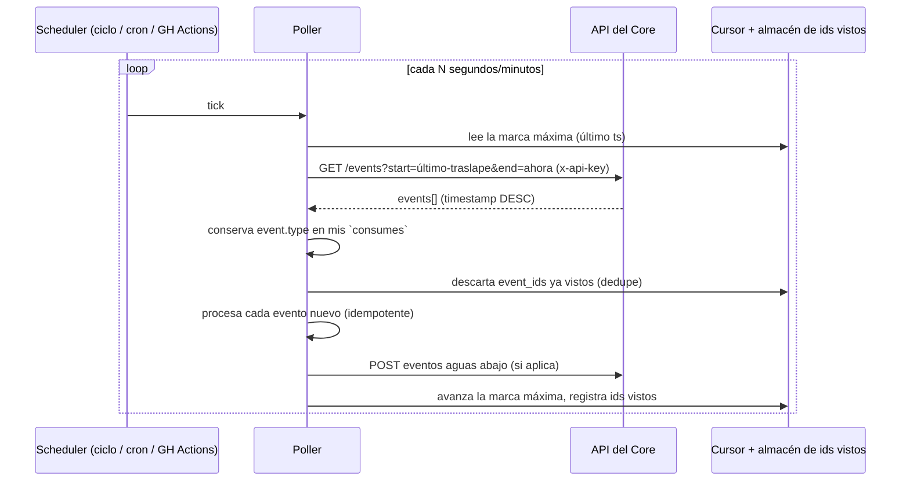
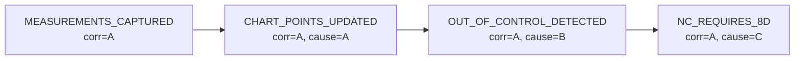
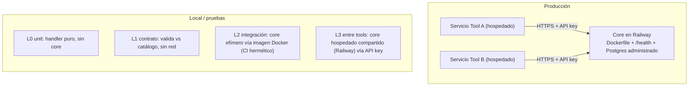
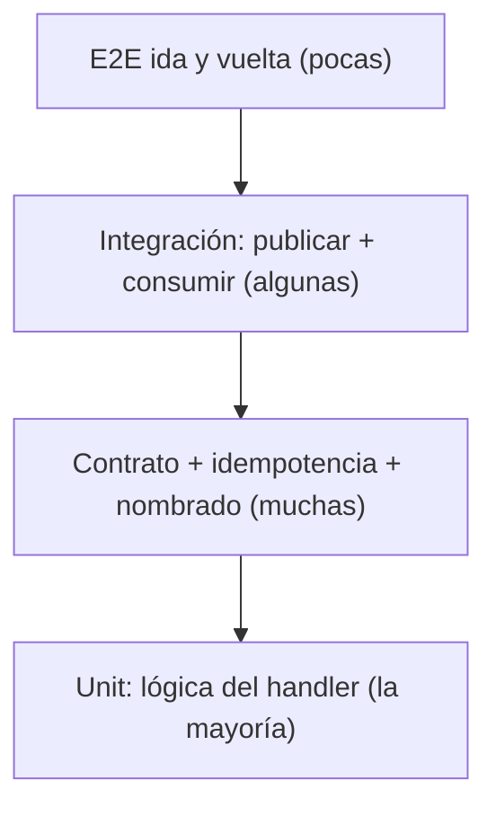
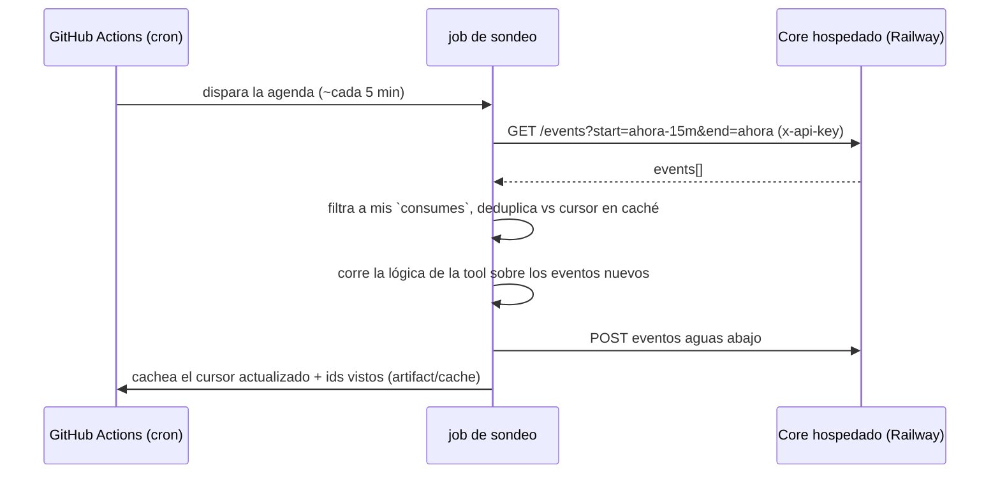

# Guía de Integración entre Tools — Plataforma Core IsoTools

Cómo las tools independientes publican eventos hacia, y consumen eventos desde, la
plataforma core compartida de IsoTools **sin que ninguna tool sepa que otra existe**. Este
es el contrato y el manual de operación para cada equipo de tools, sin importar el lenguaje
o el stack que usen.

> Audiencia: cualquiera que construya una tool que deba interoperar con el paquete ISO 9001
> a través de la plataforma core. Lee las secciones 1–6 antes de escribir código; las
> secciones 7–10 antes de abrir un PR; la sección 11 para producción.

---

## 1. El modelo mental en una imagen

La plataforma core es un **broker de eventos con una API HTTP y un almacén Postgres**. Las
tools son servicios independientes. Una tool solo le habla al **core** — nunca a otra tool.



Tres reglas que el resto del documento desarrolla:

1. **Publicar** = `POST /api/v1/events` con tu API key. Dispara y olvida.
2. **Consumir** = **sondear** (`poll`) `GET /api/v1/events` en un intervalo, filtrar por los
   tipos de evento que te interesan, deduplicar y actuar. **No hay push, ni webhook, ni
   websocket.**
3. **Las tools se desacoplan mediante un Catálogo de Eventos compartido**, no mediante
   código compartido. Un consumidor programa contra el esquema publicado de un evento, nunca
   contra el productor.

---

## 2. Qué expone realmente la plataforma core

Verificado contra el código fuente de la plataforma. La superficie de la API es
deliberadamente mínima.

| Método y ruta                             | Scope requerido | Propósito                                                                                                       |
| ----------------------------------------- | --------------- | --------------------------------------------------------------------------------------------------------------- |
| `POST /api/v1/events`                     | `events:write`  | Valida, guarda y (para tools nativas) corre la cadena in-process. Devuelve `201`.                               |
| `GET /api/v1/events?start=&end=`          | `events:read`   | Consulta eventos guardados en una **ventana de tiempo**. `start` y `end` son strings ISO-8601 **obligatorios**. |
| `GET /api/v1/events/chain/:correlationId` | `events:read`   | Devuelve la cadena causal completa de un `correlation_id`, del más viejo al más nuevo.                          |
| `GET /api/v1/health`                      | ninguno         | Liveness. Devuelve `{ status: "ok", service: "isotools", time }`.                                               |

**No** existe cursor `since_id`, **no** hay endpoint de streaming/SSE, y **no** hay filtro
por tipo de evento en la consulta. Estas ausencias moldean todo el diseño del consumidor
(sección 7).

### 2.1 Autenticación

Cada llamada a `/events` requiere un header `x-api-key`. La llave se hashea con SHA-256 y se
busca en la tabla `api_keys`; el registro trae sus **scopes** y una bandera `active`.

- Sin llave -> `401`. Llave desconocida/inactiva -> `401`. Llave sin el scope -> `403`.
- Scopes: `events:read` (GET) y `events:write` (POST). Una tool solo-publicadora necesita
  únicamente `events:write`; una tool que también consume necesita ambos.
- **Una llave por tool por ambiente**, nunca una llave compartida. Esto da revocación por
  tool y una traza de auditoría de quién ingestó qué.

```bash
# Las llaves se crean en el core, una sola vez, por el admin:
node scripts/createApiKey.js my_tool_name --scopes=events:read,events:write
# La llave en texto plano se imprime una única vez. Guárdala como secreto; la DB solo
# conserva el hash.
```

### 2.2 El sobre del evento (IES) — el contrato de transmisión

La API valida cada evento entrante con un JSON Schema estricto. Este es la **única fuente de
verdad para el sobre**. Si lo mandas mal, obtienes un `400` con los detalles.

```jsonc
{
  "event_id": "string, obligatorio, único", // ULID o UUIDv4
  "timestamp": "string, obligatorio, RFC3339 UTC", // hora del hecho, no de ingesta
  "platform_version": "string, obligatorio", // ej. "1.0"
  "module": {
    // objeto obligatorio
    "id": "string, obligatorio", // = tu tool_id (snake_case)
    "version": "string, obligatorio", // SemVer, ej. "1.0.0"
  },
  "asset": {
    // objeto obligatorio
    "asset_id": "string, obligatorio", // DEBE estar presente y no vacío
    "asset_type": "string | null",
    "plant_id": "string | null",
    "area_id": "string | null",
    "line_id": "string | null",
    "location": "string | null",
  },
  "event": {
    // objeto obligatorio
    "type": "string, obligatorio", // SCREAMING_SNAKE_CASE
    "category": "string | null",
    "severity": "string | null",
  },
  "data": {}, // objeto libre, tu payload
  "metadata": {}, // objeto libre, contexto opcional
  "correlation_id": "string | null", // el bus lo pone si lo omites
  "causation_id": "string | null",
}
```

**Cuatro trampas que te van a morder — todas confirmadas en el validador:**

1. **Los campos desconocidos se borran en silencio.** El esquema usa
   `additionalProperties: false` **y** `removeAdditional: true` en el nivel superior y dentro
   de `module` / `asset` / `event`. Cualquier campo que inventes en esos niveles se elimina
   antes de guardarse — sin error, solo datos que faltan. **Pon todo lo custom dentro de
   `data` o `metadata`**, que son objetos de forma libre.
2. **`asset.asset_id` es obligatorio** (requerido por el esquema y `NOT NULL` en la DB). Cada
   evento es acerca de un activo. Si tu tool no es específica de un activo, usa un id
   sintético estable (ej. el id de la planta) en vez de omitirlo.
3. **Los enums están documentados pero NO se enforzan.** `event.type`, `event.category` y
   `event.severity` se validan solo como strings. La API guardará felizmente
   `severity: "HIGH"` o un tipo mal escrito. Nada aguas abajo te va a advertir — tu evento
   simplemente nunca hace match con un consumidor. La disciplina la enforzan **tus pruebas**
   (sección 10), no la API.
4. **`timestamp` es tu reloj, `received_at` es el del servidor.** La consulta filtra por
   `timestamp` (ver 7.2). Manda siempre un `timestamp` honesto en UTC.

---

## 3. Los dos planos: nativo (in-process) vs externo (poliglota)

Esta es la distinción arquitectónica más importante, y la razón por la que tus compañeros no
pueden todos "nada más escribir un handler".



- **Plano nativo.** Una tool que es un solo archivo `src/tools/<id>.js` que exporta `meta` +
  `handler`, registrada en `src/tools/index.js`, cableada por una regla en
  `communication-rules.json`. Cuando llega un evento, el bus hace match de las reglas por
  `event.type`, evalúa el `triggerCondition` de la regla, y **llama al handler in-process, de
  forma síncrona, dentro del POST**. El handler debe ser una función pura: devuelve un evento
  / arreglo / `null`, sin I/O, sin llamadas salientes, idempotente. Esto solo funciona si la
  lógica puede vivir como JavaScript dentro del repo del core.

- **Plano externo.** Una tool que es **su propio servicio en su propio repo y stack** (su
  propia DB, su propio lenguaje). El bus **nunca** la va a llamar — no está en
  `src/tools/index.js`, así que `getTool()` devuelve null y el bus ignora cualquier regla que
  la apunte. Una tool externa se integra puramente sobre HTTP: **publica con POST, consume
  con sondeo.** `communication-rules.json` no le entrega nada.

> **Consecuencia para un equipo mixto:** si una tool tiene su propio servicio/DB/arquitectura,
> es una tool del plano externo. **No** intentes encajarla en `src/tools/*.js`. Sigue el
> contrato de publicar/sondear de las secciones 6–7. Los nombres de los eventos aún tienen
> que coincidir con el catálogo exactamente, porque eso es lo que acopla al publicador con el
> consumidor.

---

## 4. La regla de oro: las tools nunca se conocen entre sí — el Catálogo de Eventos

El desacoplamiento no viene del bus; viene de un **Catálogo de Eventos compartido y
versionado** contra el cual ambos lados programan. El productor emite un evento que cumple
con el catálogo. El consumidor lee el esquema del catálogo para ese tipo de evento y programa
contra **eso**, nunca contra los internos del productor.



Una entrada del catálogo por tipo de evento contiene, como mínimo:

| Campo                              | Ejemplo                                          | Por qué                                                                                            |
| ---------------------------------- | ------------------------------------------------ | -------------------------------------------------------------------------------------------------- |
| `type`                             | `DEFECT_FOUND`                                   | La llave de enrutamiento. SCREAMING_SNAKE_CASE, único global.                                      |
| `productor`                        | `inspect_product_quality`                        | Quién lo emite (informativo; los consumidores no deben depender solo de esto — ver fan-in en 7.3). |
| convención `category` / `severity` | `quality` / `high`                               | Para que los consumidores puedan pre-filtrar.                                                      |
| JSON Schema de `data`              | `{ defectFound: bool, defectType: string, ... }` | El contrato del payload. Es lo que el consumidor valida y lee.                                     |
| Semántica / disparo                | "se emite una vez por defecto confirmado"        | Elimina la ambigüedad sobre cuándo dispara.                                                        |

**Dónde vive el catálogo.** Hoy la materia prima ya existe en el repo del core:
`event-standard.json`, más los `meta.produces` / `meta.consumes` de cada tool y las aristas
de `communication-rules.json`. Para el mundo del plano externo, trata al catálogo como un
**artefacto de primera clase, versionado de forma independiente** (ver sección 11.3): las
tools deben poder obtenerlo sin clonar ni correr el core.

El contrato práctico a acordar, según la regla de coordinación de la documentación de la
plataforma:

1. El productor publica su lista exacta de `produces` y el esquema de `data` de cada evento.
2. El consumidor elige los tipos de evento que necesita, los agrega a sus `consumes`, y
   programa contra el esquema de `data` publicado.
3. Ambos registran su arista en el catálogo compartido / `communication-rules.json` para que
   el grafo quede documentado y el reporte de auditoría pueda agregarlo. **Esto es un cambio
   de JSON/documentación, no una dependencia de código.**

---

## 5. ¿Seguimos clonando el core? (respuesta corta: no, con una salvedad)

Estás en lo correcto, en esencia.

- **Para correr e integrar: nadie clona ni corre el core.** Cada tool apunta al core
  **hospedado** (Railway) usando su API key sobre HTTPS. Este es el modelo recomendado y es
  como se ve producción también.
- **Salvedad — el contrato sigue teniendo casa.** Los artefactos compartidos (Catálogo de
  Eventos / `tools.json` / `communication-rules.json`) y cualquier handler del **plano
  nativo** siguen viviendo en el repo del core. Alguien los cura. Así que el repo del core
  sigue siendo la casa del _contrato_, aunque ningún equipo de tools necesite correrlo. Dos
  formas limpias de manejarlo (sección 11.3): publicar el catálogo como un artefacto
  versionado y descargable, **o** extraerlo a un pequeño repo dedicado `event-catalog`. De
  cualquier forma, una tool consume una **versión publicada**; nunca clona el core para
  operar.
- **Un matiz solo para pruebas herméticas.** Para CI totalmente aislado (sección 9), es más
  limpio levantar un core **desechable** desde su imagen de Docker dentro del job de CI que
  correr las pruebas contra el core hospedado compartido y mutable. Eso no es "clonar para
  desarrollar"; es una dependencia de prueba desechable. La integración entre equipos sigue
  ocurriendo contra el core hospedado compartido.

---

## 6. Publicar eventos



Publicador mínimo (Node `fetch`; cualquier cliente HTTP en cualquier lenguaje funciona
igual):

```js
async function publish(event) {
  const res = await fetch(`${CORE_BASE_URL}/api/v1/events`, {
    method: 'POST',
    headers: { 'Content-Type': 'application/json', 'x-api-key': API_KEY },
    body: JSON.stringify(event),
  });
  if (res.status !== 201) {
    throw new Error(`falló la publicación: ${res.status} ${await res.text()}`);
  }
  return res.json(); // { event_id, correlation_id, triggered, chain }
}
```

Reglas del publicador:

- **Genera un `event_id` nuevo por cada evento distinto**; reutiliza el mismo id **solo** al
  reintentar exactamente el mismo evento (eso es lo que hace que un reintento sea idempotente
  para los consumidores).
- **Manda un `timestamp` real en UTC** en el momento en que ocurrió el hecho.
- **Sigue las convenciones de nombrado** (tipo en SCREAMING_SNAKE_CASE, severity en
  minúsculas del conjunto `low|medium|high|critical`, category del conjunto permitido) aunque
  la API no rechace las violaciones — tus pruebas de contrato sí deben hacerlo (sección 10).
- **Pon tu payload en `data`**, los extras contextuales en `metadata`. Nada custom en el
  nivel superior o se elimina.
- El `chain`/`triggered` de la respuesta `201` reflejan solo las reacciones **nativas**. Los
  consumidores externos no se ven afectados por eso; ignóralo más allá de confirmar la
  aceptación.

---

## 7. Consumir eventos (el poller)

Como no hay push, un consumidor corre un **ciclo de sondeo**: en un intervalo, le pide al
core los eventos recientes, filtra a los tipos a los que está suscrito, se salta los que ya
procesó, actúa sobre el resto y (normalmente) publica de vuelta eventos aguas abajo.



### 7.1 Por qué sondeo, no push

El core no tiene mecanismo de callback — las únicas rutas de lectura son `GET /events`
(ventana de tiempo) y `GET /events/chain/:id`. Así que la entrega a cualquier tool externa es
**por jalado (pull)**. Esto está bien para eventos de cadencia ISO (calibraciones, no
conformidades, cambios de spec) que son de bajo volumen; solo habría que repensarlo con
throughput alto.

### 7.2 La consulta, con precisión

`GET /api/v1/events` soporta exactamente estos parámetros:

| Parámetro   | Obligatorio | Notas                                                                           |
| ----------- | ----------- | ------------------------------------------------------------------------------- |
| `start`     | sí          | ISO-8601. Cota inferior sobre **`timestamp`** (reloj del productor), inclusiva. |
| `end`       | sí          | ISO-8601. Cota superior sobre **`timestamp`**.                                  |
| `module_id` | no          | Filtra a una tool productora.                                                   |
| `asset_id`  | no          | Filtra a un activo.                                                             |
| `limit`     | no          | Default 100, **tope duro en 1000**. Los renglones vienen `timestamp DESC`.      |

Consecuencias que debes diseñar por adelantado:

- **No hay filtro por tipo de evento del lado del servidor.** Consulta por ventana de tiempo
  (opcionalmente `module_id`) y **filtra por `event.type` en tu propio código**.
- **El filtro es sobre el `timestamp` del productor, no sobre el `received_at` del
  servidor.** Un productor con reloj desfasado, o uno que antedata un evento, puede colocar
  un renglón justo fuera de tu ventana. Mitígalo con un **traslape/retroceso (lookback)**
  (reconsulta unos minutos hacia el pasado en cada tick) y apóyate en la deduplicación.
- **El tope de 1000 renglones = sin paginación profunda.** Si una sola ventana pudiera
  exceder 1000 eventos, reduce la ventana. Para los volúmenes de eventos ISO esto es un no
  problema; ten presente que existe.
- **No puedes marcar un evento como "procesado" en el core** (los campos desconocidos se
  eliminan, y no hay endpoint de actualización). Lleva el registro de los `event_id`
  procesados en **tu propio** almacén.

### 7.3 El algoritmo de sondeo (al-menos-una-vez, idempotente)

```js
// Pseudocódigo — la misma forma en cualquier lenguaje.
const LOOKBACK_MS = 5 * 60 * 1000; // traslape para absorber desfase de reloj y llegadas tardías
const MY_TYPES = new Set(['CALIBRATION_FAILED', 'DEFECT_FOUND']); // los `consumes` de esta tool

async function pollOnce(state) {
  const now = new Date();
  const start = new Date(Math.min(state.highWater, now.getTime()) - LOOKBACK_MS);
  const url =
    `${CORE_BASE_URL}/api/v1/events` +
    `?start=${start.toISOString()}&end=${now.toISOString()}&limit=1000`;

  const res = await fetch(url, { headers: { 'x-api-key': API_KEY } });
  if (!res.ok) throw new Error(`falló el sondeo: ${res.status}`);
  const { events } = await res.json();

  // Del más viejo al más nuevo para preservar el orden causal; la API devuelve DESC.
  const batch = events
    .filter((e) => MY_TYPES.has(e.event_type)) // filtro de tipo del lado del cliente
    .filter((e) => !state.seen.has(e.event_id)) // deduplica
    .sort((a, b) => new Date(a.timestamp) - new Date(b.timestamp));

  for (const e of batch) {
    await handle(e); // DEBE ser idempotente (ver 8)
    state.seen.add(e.event_id); // persiste esto
  }

  state.highWater = now.getTime(); // persiste esto (durable entre reinicios)
}
```

- **`handle()` debe ser idempotente** y seguro de correr de nuevo: la ventana de traslape
  garantiza que ocasionalmente verás el mismo evento dos veces. Ancla los efectos secundarios
  al `event_id` (o a un id determinista derivado de él), para que una repetición sea un
  no-op.
- **Persiste `highWater` y `seen`** para que un reinicio no reproduzca todo ni deje un hueco.
  Un conjunto `seen` acotado/rodante (ej. por event_id con un TTL más largo que el lookback)
  es suficiente.

### 7.4 Consultar datos específicos bajo demanda

Más allá del ciclo de suscripción, la misma API de lectura responde preguntas dirigidas:

- **"¿Qué emitió recientemente el productor X?"** -> `GET /events?start=&end=&module_id=X`.
- **"¿Todo sobre un activo en una ventana?"** -> agrega `&asset_id=...`.
- **"¿La historia causal completa detrás de un evento?"** -> guarda el `correlation_id` que
  obtuviste al publicar, luego `GET /events/chain/:correlationId` para la cadena ordenada
  (cada renglón trae su `causation_id` = el padre que lo disparó).

---

## 8. Semántica de entrega, orden y trazabilidad

| Propiedad           | Qué te da el core                                                                                                           | Qué debe hacer tu tool                                                                                                                                                       |
| ------------------- | --------------------------------------------------------------------------------------------------------------------------- | ---------------------------------------------------------------------------------------------------------------------------------------------------------------------------- |
| Entrega             | **Al-menos-una-vez** (los sondeos traslapados reentregan)                                                                   | Deduplicar por `event_id`; hacer los handlers idempotentes.                                                                                                                  |
| Orden               | Best-effort por `timestamp`; no garantizado entre productores                                                               | Ordena tu lote del más viejo al más nuevo; no asumas orden global.                                                                                                           |
| Exactamente-una-vez | No se provee                                                                                                                | Logra _efectivamente-una-vez_ vía llaves de idempotencia.                                                                                                                    |
| Trazabilidad        | `correlation_id` (raíz de la cadena) + `causation_id` (padre inmediato), auto-rellenados por el bus para reacciones nativas | Cuando publiques una **reacción** a un evento, propaga su `correlation_id` y pon `causation_id` al `event_id` que lo disparó, para que el endpoint de cadena teja tu evento. |



> Las reacciones nativas obtienen `correlation_id`/`causation_id` rellenados automáticamente
> por el bus. Un consumidor **externo** que reacciona a un evento debe cargar estos él mismo
> cuando publica, para que las cadenas entre tools sigan siendo trazables de punta a punta.

---

## 9. Producción vs pruebas locales — topología



**Producción.** El core corre en Railway desde su `Dockerfile` (`startCommand:
node src/server.js`, healthcheck `/api/v1/health`, Postgres administrado vía
`DATABASE_URL`). Cada tool es su **propio** servicio hospedado (Railway, Fly.io, una VM
chica, o un runner agendado) que le habla al core sobre HTTPS con su API key. Nada está
co-ubicado; nada comparte proceso.

**Local / pruebas — una estrategia por capas** (elige la capa más baja que pruebe lo que
necesitas):

- **L0 — Unit.** Prueba tu handler/lógica como función pura contra fixtures canónicos de
  eventos. Sin core, sin red. Rápido, corre en cada commit.
- **L1 — Contrato/esquema.** Valida cada evento que _produces_ contra el sobre del core y el
  esquema de `data` del catálogo; valida cada fixture que _consumes_ contra el catálogo. Sin
  red. Esto es lo que de verdad enforza la disciplina de nombrado/enums que la API no.
- **L2 — Integración (hermética).** Levanta un core **desechable** en CI desde su imagen de
  Docker + Postgres, crea una API key temporal, haz POST/sondeo contra `localhost`, verifica
  el comportamiento, y tíralo. Determinista y aislado — el default correcto para CI.
- **L3 — Integración entre tools.** Apunta al core hospedado **compartido** con una API key
  real para verificar que tu tool interopera con las tools vivas de los demás. Esto es para
  integración de equipo y demos, no para verificar lógica de grano fino (un core compartido y
  mutable vuelve frágiles las aserciones estrictas).

> Recomendación: corre L0–L2 en el CI de cada repo en cada PR (hermético, confiable). Usa L3
> en un intervalo agendado y antes de los releases. Esto respeta "todos usan la plataforma
> hospedada" para las verificaciones reales entre tools mientras mantiene las pruebas de
> unit/lógica deterministas.

---

## 10. Estandarización — la suite de pruebas que CADA repo de tool DEBE traer

Para garantizar que todos publican y consumen correctamente, cada repo de tool trae la
**misma suite obligatoria**, programada contra **fixtures compartidos** que viven junto con
el Catálogo de Eventos. Este es el contrato del "todos deben tenerlo".



Pruebas obligatorias, por tool:

1. **Prueba de contrato del productor.** Para **cada** evento en `produces`: construye un
   evento representativo y verifica que (a) pasa el esquema del sobre del core y (b) hace
   match con el esquema de `data` del catálogo para ese tipo. Protege contra campos
   silenciosamente eliminados y drift.
2. **Prueba de contrato del consumidor.** Para **cada** evento en `consumes`: carga el
   **fixture compartido** de ese tipo y verifica que tu handler lo acepta y produce los
   eventos de salida esperados. Pruebas contra la muestra canónica del catálogo, nunca contra
   una hecha a mano — así, un cambio del productor al fixture rompe tu build temprano.
3. **Prueba de lint de nombrado/enums.** Verifica que cada valor de `produces`/`consumes` es
   SCREAMING_SNAKE_CASE y existe en el catálogo; `severity ∈ {low,medium,high,critical}`;
   `category ∈` el conjunto permitido. (La API no lo hará por ti.)
4. **Prueba de integración de publicación (L2).** Haz POST de un evento real a un core
   efímero; verifica el `201` y que un `GET /events` posterior (con la ventana de tiempo
   correcta) lo devuelve.
5. **Prueba de integración de consumo (L2).** Siembra el core efímero con un evento aguas
   arriba; corre el poller una vez; verifica que la tool reaccionó (publicó el evento aguas
   abajo correcto y/o actualizó su propio estado).
6. **Prueba de idempotencia.** Entrega el mismo `event_id` dos veces a través del poller;
   verifica exactamente un efecto secundario lógico y una salida idéntica.
7. **Prueba E2E ida y vuelta (L2/L3).** Publica el evento aguas arriba que debería disparar
   esta tool; sondea; verifica que el evento aguas abajo aparece con el **mismo
   `correlation_id`** y un `causation_id` que apunta al disparador. Prueba que la cadena está
   intacta de punta a punta.
8. **Prueba de resiliencia del poller.** Las ventanas traslapadas no procesan doble (el
   dedupe funciona); un `5xx`/timeout del core se reintenta con backoff; el cursor de marca
   máxima sobrevive un reinicio (sin hueco, sin reproducir todo).

Trae un pequeño **paquete de fixtures** junto con el catálogo — un `event-example` canónico
por tipo de evento — para que las pruebas 1, 2 y 7 en cada repo verifiquen contra los
_mismos_ payloads. El drift de contrato entonces rompe un build en algún lado de inmediato,
que es justamente el punto.

---

## 11. CI/CD y el poller de GitHub Actions

### 11.1 CI de contrato en cada PR (todas las tools, idéntico)

Cada repo de tool corre L0–L2 en cada pull request: lint + unit + contrato, luego levanta el
core efímero y corre las pruebas de integración de publicación/consumo/idempotencia/ida y
vuelta. Un PR que rompe el sobre o el contrato del catálogo no puede mergear.

```yaml
# .github/workflows/contract-ci.yml
name: contract-ci
on: [pull_request]
jobs:
  test:
    runs-on: ubuntu-latest
    services:
      postgres:
        image: postgres:16
        env:
          {
            POSTGRES_USER: industrial,
            POSTGRES_PASSWORD: industrial,
            POSTGRES_DB: industrial_events,
          }
        ports: ['5432:5432']
        options: >-
          --health-cmd "pg_isready -U industrial" --health-interval 10s
          --health-timeout 5s --health-retries 5
    steps:
      - uses: actions/checkout@v4
      - uses: actions/setup-node@v4
        with: { node-version: '20' }
      - run: npm ci
      - run: npm run lint
      - run: npm test # L0 unit + L1 contrato
      # L2: levanta un core efímero (desde su imagen publicada o un submódulo), crea una
      # llave temporal, luego corre las pruebas de integración contra http://localhost:3000
      - run: npm run test:integration
```

### 11.2 El poller agendado de GitHub Actions (para pruebas de integración con el core compartido)

Durante la fase de pruebas/integración, en vez de que cada desarrollador mantenga vivo un
demonio poller en su laptop, usa un **workflow agendado de GitHub Actions como el poller
siempre-encendido** contra el core hospedado compartido. Despierta en un cron, sondea una
vez, deja que la tool reaccione, y publica de vuelta los eventos aguas abajo. Suficientemente
bueno para integración y demos; ten en cuenta las salvedades de abajo.



```yaml
# .github/workflows/poller.yml
name: poller
on:
  schedule:
    - cron: "*/5 * * * *"   # la cadencia más apretada usable de GitHub; best-effort, puede retrasarse
  workflow_dispatch: {}      # permite corridas manuales
concurrency:
  group: poller              # nunca corras dos pollers a la vez
  cancel-in-progress: false
jobs:
  poll:
    runs-on: ubuntu-latest
    steps:
      - uses: actions/checkout@v4
      - uses: actions/setup-node@v4
        with: { node-version: "20" }
      - run: npm ci
      # Restaura el cursor durable + ids vistos entre corridas.
      - uses: actions/cache@v4
        with: { path: .poller-state, key: poller-state-${{ github.run_id }}, restore-keys: poller-state- }
      - run: node scripts/poll-once.js
        env:
          CORE_BASE_URL: ${{ secrets.CORE_BASE_URL }}
          API_KEY:       ${{ secrets.CORE_API_KEY }}
```

Salvedades para calibrar expectativas:

- **El cron es best-effort y no más apretado que ~5 minutos** en GitHub — bien para eventos
  de cadencia ISO, no para tiempo real. Para debugging local activo, corre la misma lógica de
  `poll-once` en un ciclo `while` local (nivel de segundos).
- **El estado entre corridas no es automático.** Persiste el cursor/ids-vistos vía
  `actions/cache` o un artifact del job (como arriba), o el poller reescanea todo su lookback
  en cada corrida — inofensivo si los handlers son idempotentes, pero desperdicia.
- **Usa `concurrency`** para que dos corridas agendadas nunca se traslapen y procesen doble.
- **Los secretos** (`CORE_BASE_URL`, `CORE_API_KEY`) viven en los secrets del repo/ambiente,
  nunca en el YAML.

### 11.3 Publicar el Catálogo de Eventos para que nadie clone el core

Para que las tools dependan del _contrato_ sin clonar el core, publica el catálogo como un
**artefacto versionado** y haz que las tools obtengan una versión fijada (pinned):

- Etiqueta el catálogo (`event-standard.json` + esquemas de `data` por tipo + fixtures) y
  publícalo como asset de un release, un paquete diminuto, o una URL cruda fijada a un tag;
  **o** muévelo a un repo pequeño y dedicado `event-catalog`.
- Cada tool fija una **versión** del catálogo y actualiza deliberadamente. Un release del
  catálogo es un cambio de contrato — fluye a través del CI de Contrato de cada tool (11.1),
  que es exactamente donde quieres que la ruptura salga a la luz.

---

## 12. Un repo de tool, de un vistazo

```
tu-tool/
  src/                     # tu servicio: publicador, poller, lógica de negocio (cualquier stack)
  scripts/
    poll-once.js           # una iteración de sondeo (usada por el ciclo Y por GH Actions)
    publish.js             # helper delgado de POST
  test/
    unit/                  # L0
    contract/              # L1 (valida contra el catálogo fijado + fixtures)
    integration/           # L2 (core efímero)
  catalog.lock             # versión fijada del Catálogo de Eventos contra la que programa esta tool
  .github/workflows/
    contract-ci.yml        # L0-L2 en cada PR
    poller.yml             # poller agendado del core compartido (fase de pruebas)
  Dockerfile               # si se hospeda como servicio siempre-encendido
  .env.example             # CORE_BASE_URL, API_KEY (nunca commitear los reales)
```

Variables de entorno que cada tool usa:

| Var                | Significado                                                                                            |
| ------------------ | ------------------------------------------------------------------------------------------------------ |
| `CORE_BASE_URL`    | URL base del core (`https://<app>.up.railway.app` en prod; `http://localhost:3000` para L2).           |
| `API_KEY`          | La llave de esta tool, con scope `events:read,events:write` (o `events:write` si es solo-publicadora). |
| `POLL_LOOKBACK_MS` | Ventana de traslape para el poller (ej. 300000).                                                       |
| `POLL_INTERVAL_MS` | Cadencia del ciclo para el demonio local (el cron la ignora).                                          |

---

## 13. Haz / No hagas

**Haz**

- Habla solo con el core; trata a cualquier otra tool como inalcanzable y desconocida.
- Programa los consumidores contra el esquema de `data` del catálogo, no contra un productor.
- Haz cada handler idempotente y deduplica por `event_id`.
- Mantén los campos custom dentro de `data`/`metadata`; manda `timestamp`s honestos en UTC.
- Enforza la disciplina de nombrado/enums en tus propias pruebas — la API no lo hará.
- Persiste el cursor del poller y los ids vistos; usa traslape + dedupe.

**No hagas**

- No llames directo al servicio de otra tool, ni importes su código.
- No esperes push/webhook/stream — no existe; sondea.
- No inventes campos de nivel superior ni en `module`/`asset`/`event` — se eliminan en
  silencio.
- No confíes en que `event.category`/`severity`/`type` los valide el core.
- No corras aserciones de lógica estrictas contra el core hospedado compartido; usa un core
  efímero.
- No compartas una API key entre tools; una llave por tool por ambiente.

---

## 14. Referencia rápida de endpoints

```
POST /api/v1/events                     x-api-key (events:write)   -> 201 { event_id, correlation_id, triggered, chain }
GET  /api/v1/events?start=&end=         x-api-key (events:read)    -> 200 { count, events[] }   (+ opcional module_id, asset_id, limit<=1000)
GET  /api/v1/events/chain/:correlationId x-api-key (events:read)   -> 200 { correlation_id, count, events[] }  (del más viejo al más nuevo)
GET  /api/v1/health                      ninguno                   -> 200 { status:"ok", service:"isotools", time }
```

Errores: `400` sobre inválido (con `details`) o `start`/`end` mal/faltantes; `401` llave
faltante/inválida; `403` la llave no tiene el scope requerido.
