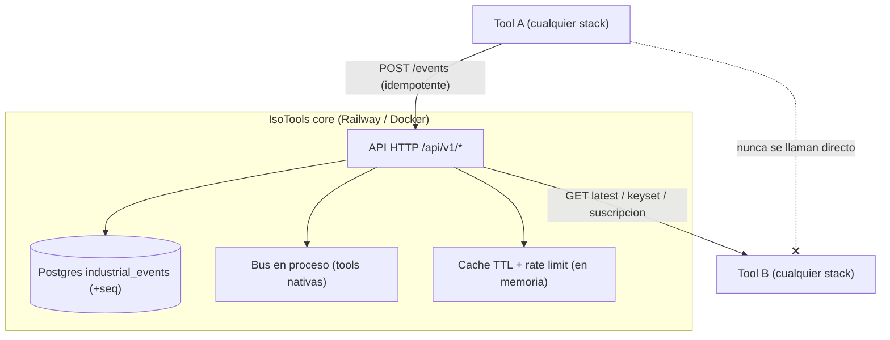
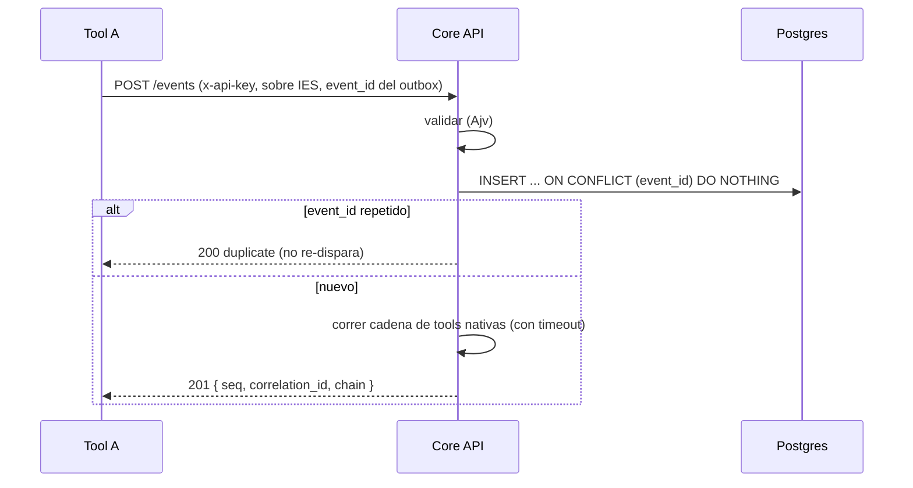
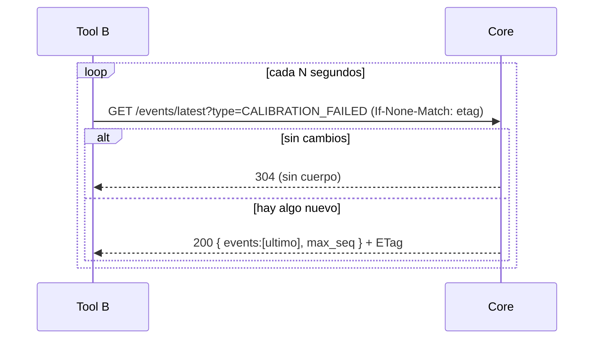
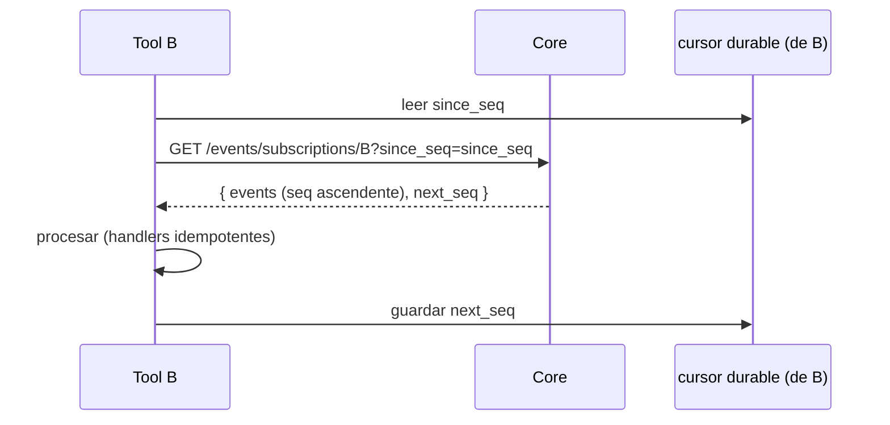

# Plataforma Cloud de Eventos — IsoTools

Este documento explica los cambios que convierten a **IsoTools-main** en la
**plataforma central** que otras tools usan para **publicar y consumir** eventos
en la nube, sin que ninguna tool conozca a las demas. Cubre que se modifico, la
nueva superficie HTTP, el flujo completo de publicacion/consumo y los patrones de
resiliencia aplicados.

Publico: cualquiera que opere el core o programe una tool que se integre con el.
Complementa (no reemplaza) a `docs/GUIA_TOOLS.md` y a la guia de integracion
inter-tool que traen las tools productoras/consumidoras.

---

## 0. Resumen

- El core sigue siendo un **broker de eventos con API HTTP y Postgres**. Las tools
  hablan **solo** con el core: publican con `POST` y consumen con `GET` (poll).
- Se elimino el **over-fetch**: antes, consumir obligaba a pedir una ventana de
  tiempo completa y filtrar en el cliente. Ahora el core **filtra del lado del
  servidor** (por tipo, tool, activo, categoria, severidad) y ofrece un
  **cursor incremental** y un endpoint de **ultimo evento por tipo**.
- Se agrego lo necesario para operar **de forma continua** en la nube: ingesta
  **idempotente**, **cache** para el poll caliente, **ETag/304**, **rate limit**,
  **timeouts**, **readiness** y **apagado ordenado**.
- **Cero dependencias nuevas** y **compatibilidad hacia atras**: los endpoints y
  formatos previos siguen funcionando.

---

## 1. El problema que resuelve

El contrato es: si la tool B necesita datos de la tool A, **los consume del core**
(la ultima data que A publico); A y B no se comunican directamente ni se conocen.

La API anterior exponia una sola lectura util, `GET /events?start=&end=`, que:

1. Obligaba a traer **todos** los eventos de una ventana de tiempo y **descartar en
   el cliente** los tipos que no interesan. Eso es **over-fetch**: ancho de banda y
   CPU desperdiciados, y lecturas mas lentas conforme crece el volumen.
2. No permitia pedir **solo el ultimo** evento de un tipo (el caso "B quiere la
   ultima data publicada por A").
3. Dependia del `timestamp` del productor (sujeto a desfase de reloj), forzando
   ventanas de solape y de-duplicacion en cada consumidor.

La solucion elegida (ver seccion 5) es **un recurso de coleccion con filtros del
lado del servidor + un cursor monotono + una proyeccion "latest" + una vista de
suscripcion por tool**. Es mas escalable que crear un endpoint por tool (125 tools
darian una explosion de rutas imposible de cachear y mantener) y mas preciso que
filtrar en el cliente.

---

## 2. Modelo mental



Reglas que no cambian:

1. **Publicar** = `POST /api/v1/events` con API key. Idempotente por `event_id`.
2. **Consumir** = **poll** por `GET` con la key. No hay push/webhook/websocket.
3. El acoplamiento es por el **catalogo de eventos** (tipos), no por codigo
   compartido. Un consumidor codifica contra el tipo de evento, nunca contra el
   productor.

---

## 3. Que se modifico (por archivo)

| Archivo                                | Cambio                                                                                                                                                                                                                    |
| -------------------------------------- | ------------------------------------------------------------------------------------------------------------------------------------------------------------------------------------------------------------------------- |
| `src/config.js`                        | **NUEVO.** Configuracion central por variables de entorno (pool, limites, cache, rate limit, timeouts, apagado). Un solo lugar de verdad.                                                                                 |
| `src/db/index.js`                      | Pool configurable (`PG_POOL_MAX`, timeouts) + `statement_timeout` para cortar consultas colgadas. Parser de `BIGINT`->Number para exponer `seq` como numero. `pingDb()` para readiness.                                   |
| `src/db/capabilities.js`               | **NUEVO.** Flags de capacidad detectados al arrancar (`hasSeq`, `hasEventIdUnique`) para degradar con gracia en bases viejas.                                                                                             |
| `src/db/migrate.js`                    | Espera a la DB con reintentos; agrega columna `seq` (cursor), indice unico de `event_id` (idempotencia) e indices compuestos; detecta capacidades. Sigue siendo **no fatal**.                                             |
| `db/init.sql`                          | Mismo esquema para instalaciones nuevas: `seq BIGINT IDENTITY`, `UNIQUE(event_id)`, indices `(event_type, seq)` y `(module_id, seq)`.                                                                                     |
| `src/services/eventsService.js`        | Ingesta **idempotente** (`ON CONFLICT`); consulta con **filtros server-side** y **modo keyset**; **`fetchLatest`** (ultimo por tipo); **`fetchForSubscriber`** (por `consumes`); invalidacion de cache en cada escritura. |
| `src/services/catalogService.js`       | **NUEVO.** Carga los JSON de configuracion una vez y deriva `consumes`/`produces` por tool y el catalogo (productores/consumidores por tipo).                                                                             |
| `src/services/cache.js`                | **NUEVO.** Cache TTL/LRU en proceso para `latest` + helper de ETag.                                                                                                                                                       |
| `src/middleware/rateLimit.js`          | **NUEVO.** Rate limit por API key (ventana fija en memoria).                                                                                                                                                              |
| `src/controllers/eventsController.js`  | Ingesta 201/200 idempotente con timeout de la cadena del bus; query con keyset/ventana + filtros; `latest` con ETag/304; `subscriptions`.                                                                                 |
| `src/controllers/catalogController.js` | **NUEVO.** Expone el catalogo (contrato) en solo lectura.                                                                                                                                                                 |
| `src/routes/eventsRoutes.js`           | Rutas nuevas (`/latest`, `/subscriptions/:toolId`) + rate limit tras la auth.                                                                                                                                             |
| `src/routes/catalogRoutes.js`          | **NUEVO.** Rutas del catalogo.                                                                                                                                                                                            |
| `src/server.js`                        | Monta el catalogo; `trust proxy`; `/ready` (readiness); **apagado ordenado** (SIGTERM/SIGINT).                                                                                                                            |
| `.env.example`                         | Documenta todas las variables nuevas.                                                                                                                                                                                     |

No se agregaron dependencias de runtime. No se toco el codigo de las tools ni los
JSON de `src/data/agents/`.

---

## 4. Superficie HTTP (referencia)

Autenticacion por `x-api-key` en todo `/events` (scopes `events:read` para GET,
`events:write` para POST). El catalogo y health/ready son abiertos.

### POST `/api/v1/events` — publicar (idempotente)

Valida el sobre IES, lo guarda y dispara la cadena de tools nativas. **Reintentar
el mismo `event_id` no crea filas duplicadas**: responde `200` con
`status:"duplicate"` y no re-dispara la cadena. Un evento nuevo responde `201`.

```jsonc
// 201 (nuevo)
{ "status": "accepted", "event_id": "...", "correlation_id": "...",
  "seq": 42, "triggered": 1, "chain": [ ... ] }
// 200 (reintento idempotente)
{ "status": "duplicate", "event_id": "...", "correlation_id": "...",
  "seq": 42, "triggered": 0, "chain": [] }
```

### GET `/api/v1/events` — consultar (dos modos + filtros)

| Param                  | Notas                                                                                                                         |
| ---------------------- | ----------------------------------------------------------------------------------------------------------------------------- |
| `since_seq`            | **Modo keyset (recomendado).** Devuelve `seq > since_seq` en orden ascendente. Sin ventana de tiempo, sin de-dup del cliente. |
| `start`, `end`         | **Modo ventana (compat).** ISO-8601 sobre `timestamp`. Obligatorios si no hay `since_seq`.                                    |
| `type`                 | Filtra por tipo(s) de evento. CSV o repetido: `?type=A,B` o `?type=A&type=B`. **Evita el over-fetch.**                        |
| `module_id`            | Filtra por tool productora.                                                                                                   |
| `asset_id`             | Filtra por activo.                                                                                                            |
| `category`, `severity` | Filtros adicionales del sobre.                                                                                                |
| `limit`                | Default 100, tope duro 1000.                                                                                                  |

Respuesta: `{ count, next_seq, events[] }`. `next_seq` es el `seq` mas alto del
lote: mandalo como `since_seq` en el siguiente tick para avanzar el cursor.

### GET `/api/v1/events/latest` — la ultima data por tipo

Devuelve el **evento mas reciente por cada `event_type`** que cumpla el filtro.
Es el primitivo de menor over-fetch para "B quiere lo ultimo que publico A".

| Param                   | Notas                                                                          |
| ----------------------- | ------------------------------------------------------------------------------ |
| `type`                  | Uno o varios (CSV). Con un tipo, devuelve un evento; con varios, uno por tipo. |
| `module_id`, `asset_id` | Acotan el "ultimo" a esa tool o ese activo.                                    |

Respuesta: `{ count, max_seq, events[] }`. Trae **ETag**; si el cliente reenvia
`If-None-Match` con el mismo ETag y no hubo cambios, responde **304** sin cuerpo
(ahorra ancho de banda en el poll continuo). Cacheado en memoria (TTL corto).

### GET `/api/v1/events/subscriptions/:consumerToolId` — solo lo suyo

El core lee el `consumes` de esa tool en `tools.json` y devuelve **solo esos
tipos**. El consumidor nombra unicamente su propio id; **no necesita saber quien
produce**. Soporta `since_seq` (keyset) y `limit`.

Respuesta: `{ consumer, consumes[], count, next_seq, events[] }`. Tool desconocida
-> `404`.

### GET `/api/v1/events/chain/:correlationId` — cadena causal

La cadena completa de un `correlation_id`, orden cronologico. (Sin cambios de
contrato; ahora ordena por `seq` cuando esta disponible.)

### GET `/api/v1/catalog/*` — el contrato publicado (abierto)

- `GET /api/v1/catalog/event-standard` — el IES.
- `GET /api/v1/catalog/events` — por tipo de evento: `producers[]` y `consumers[]`.
- `GET /api/v1/catalog/tools/:toolId` — `consumes`/`produces` de una tool.

Permite descubrir el contrato **sin clonar el core**.

### Salud

- `GET /api/v1/health` — **liveness** (el proceso responde; no toca la DB).
- `GET /api/v1/ready` — **readiness** (comprueba la DB; `503` si no hay base). El
  orquestador solo debe enrutar trafico cuando esto responde `200`.

---

## 5. Como elegir endpoint (evitar el over-fetch)

| Lo que necesitas                                              | Usa                                           | Por que                                         |
| ------------------------------------------------------------- | --------------------------------------------- | ----------------------------------------------- |
| La **ultima** data de un tipo (estado actual)                 | `GET /events/latest?type=X`                   | Una fila por tipo. Cache + 304. Minimo trafico. |
| Reaccionar a **todo lo nuevo que me toca**, de forma continua | `GET /events/subscriptions/:miId?since_seq=N` | Solo mis `consumes`, incremental por cursor.    |
| Lo nuevo de **un tipo/tool** concreto, incremental            | `GET /events?since_seq=N&type=X`              | Keyset + filtro server-side.                    |
| Un **rango historico** (auditoria, reportes)                  | `GET /events?start=&end=&type=`               | Ventana acotada + filtro.                       |
| La **historia causal** de un evento                           | `GET /events/chain/:id`                       | Cadena por `correlation_id`.                    |

Regla practica: **pide por cursor (`since_seq`) y filtra por `type`/suscripcion**.
Reserva la ventana de tiempo para consultas historicas puntuales.

Por que no un endpoint por tool: con 125 tools seria una explosion de rutas,
imposible de cachear, versionar y componer. Un recurso de coleccion con filtros y
cursor es el patron REST escalable; la proyeccion `latest` y la vista
`subscriptions` cubren los dos casos de consumo mas comunes con costo minimo.

---

## 6. El nuevo flujo

### Publicar (productor)



Reintentar con el **mismo `event_id`** es seguro: el core deduplica. El productor
usa el id de su outbox como `event_id` para lograrlo.

### Consumir la ultima data (patron estado)



### Consumir incremental por cursor (patron flujo)



Con el cursor `seq` no hace falta ventana de solape ni de-duplicacion: `seq` es
estrictamente creciente y unico, inmune al desfase de reloj del productor. (El
modo ventana con solape sigue disponible para consumidores que aun no adoptan el
cursor.)

---

## 7. Patrones de diseno y resiliencia aplicados

| Patron                                   | Donde                               | Que aporta                                                                                                  |
| ---------------------------------------- | ----------------------------------- | ----------------------------------------------------------------------------------------------------------- |
| **Idempotencia** (dedupe por `event_id`) | ingesta                             | Reintentos del productor seguros; sin filas ni efectos duplicados.                                          |
| **Cursor / keyset pagination** (`seq`)   | consumo                             | Poll incremental O(log n), exacto y barato; sin solape ni de-dup.                                           |
| **Filtrado server-side**                 | consumo                             | Elimina el over-fetch: se transfiere solo lo que se consume.                                                |
| **Proyeccion de lectura** (`latest`)     | consumo                             | Sirve el estado actual con una fila por tipo.                                                               |
| **Cache-aside con TTL**                  | `latest`                            | Absorbe el poll caliente; la carga a Postgres queda acotada por la tasa de escritura, no por la de lectura. |
| **Peticiones condicionales** (ETag/304)  | `latest`                            | Ahorra ancho de banda cuando no hay cambios.                                                                |
| **Rate limiting**                        | todas las rutas                     | Protege el core de un poller en bucle o un cliente abusivo.                                                 |
| **Timeout / bulkhead**                   | cadena del bus, `statement_timeout` | Una tool o consulta lenta no bloquea la ingesta ni agota el pool.                                           |
| **Reintentos con backoff**               | arranque/migracion                  | Detecta bien las capacidades pese a blips transitorios de la DB.                                            |
| **Degradacion con gracia**               | capacidades del esquema             | En bases viejas sin `seq`/unique, la API funciona en modo compatible.                                       |
| **Health vs readiness**                  | `/health`, `/ready`                 | El orquestador solo enruta cuando hay DB.                                                                   |
| **Apagado ordenado**                     | SIGTERM/SIGINT                      | En un redeploy drena requests en vuelo y cierra el pool; sin cortes.                                        |
| **Connection pooling**                   | Postgres                            | Reuso de conexiones acotado y configurable.                                                                 |

---

## 8. Configuracion (variables de entorno)

Todas tienen defaults seguros; ver `.env.example`.

| Variable                                    | Default    | Para que                                            |
| ------------------------------------------- | ---------- | --------------------------------------------------- |
| `PG_POOL_MAX`                               | 10         | Tamaño del pool de Postgres.                        |
| `PG_STATEMENT_TIMEOUT_MS`                   | 15000      | Corta consultas colgadas en Postgres.               |
| `PG_CONNECTION_TIMEOUT_MS`                  | 5000       | Timeout de conexion al pool.                        |
| `EVENTS_DEFAULT_LIMIT` / `EVENTS_MAX_LIMIT` | 100 / 1000 | Limite por defecto y tope duro de consulta.         |
| `CACHE_ENABLED`                             | true       | Activa/desactiva el cache de `latest`.              |
| `CACHE_LATEST_TTL_MS`                       | 1500       | TTL del cache de `latest`.                          |
| `RATE_LIMIT_ENABLED`                        | true       | Activa el rate limit.                               |
| `RATE_LIMIT_WINDOW_MS` / `RATE_LIMIT_MAX`   | 1000 / 50  | Ventana y tope por API key.                         |
| `BUS_CHAIN_TIMEOUT_MS`                      | 8000       | Tope de la cadena de tools nativas dentro del POST. |
| `SHUTDOWN_GRACE_MS`                         | 10000      | Margen del apagado ordenado.                        |

---

## 9. Despliegue en la nube

Sin cambios de topologia: `Dockerfile` + `railway.toml` (start `node src/server.js`,
healthcheck `/api/v1/health`, Postgres gestionado via `DATABASE_URL`). La migracion
idempotente corre al arrancar, asi que **no hay pasos manuales de SQL**.

```bash
# Local con Docker Compose (Postgres + API):
docker compose --profile api up -d
curl http://localhost:3000/api/v1/health
curl http://localhost:3000/api/v1/ready

# Crear API key (se muestra una sola vez):
npm run apikey:create mi-tool -- --scopes=events:read,events:write
```

En produccion cada tool es su propio servicio y apunta al core por HTTPS con su
propia key (una key por tool por entorno).

---

## 10. Compatibilidad hacia atras

- `POST /events`, `GET /events?start=&end=` y `GET /events/chain/:id` conservan su
  contrato. `GET /events` ahora **agrega** `next_seq` a la respuesta y `seq` a cada
  fila (campos aditivos); los consumidores existentes que leen por nombre de campo
  no se ven afectados.
- El bus de tools nativas y los 5 JSON de `src/data/agents/` no cambian.
- La ingesta idempotente requiere el indice unico de `event_id`. La migracion lo
  crea; si una base preexistente ya tuviera `event_id` duplicados, el indice no se
  crea (no fatal) y la ingesta sigue funcionando **sin** dedupe hasta que se limpien
  los duplicados. Se registra en el log al arrancar.

---

## 11. Escalado a varias instancias

- El **cache** y el **rate limit** son **en proceso** (por instancia). Con varias
  replicas: el cache da un TTL efectivo por instancia (correcto, solo menos aciertos)
  y la cuota de rate limit es por instancia (multiplicala por el numero de replicas
  o antepon un limitador compartido). Para cache/limite globales, se antepone un
  store compartido (p. ej. Redis) sin cambiar la superficie HTTP.
- El **cursor `seq`** y la **idempotencia** viven en Postgres: son correctos con
  cualquier numero de instancias.
- Postgres es el cuello de botella natural; los indices `(event_type, seq)` y
  `(module_id, seq)` sostienen `latest` y el consumo por cursor de forma eficiente.

---

## 12. Verificacion

El core se probo de extremo a extremo contra un Postgres real: salud/readiness,
catalogo, autenticacion (401/403), ingesta idempotente (201 nuevo / 200 duplicado,
una sola fila almacenada, sin re-disparo), filtro por tipo server-side,
paginacion por cursor (`since_seq` ascendente + avance de cursor), `latest`
(uno por tipo + ETag + 304 + refleja el mas nuevo + multi-tipo), suscripcion por
`consumes` (+ 404 en tool desconocida), cadena causal, y rate limit (429 bajo
rafaga). La cadena de tools nativas del paquete ISO 9001 sigue disparando en el
POST, confirmando la compatibilidad hacia atras.
